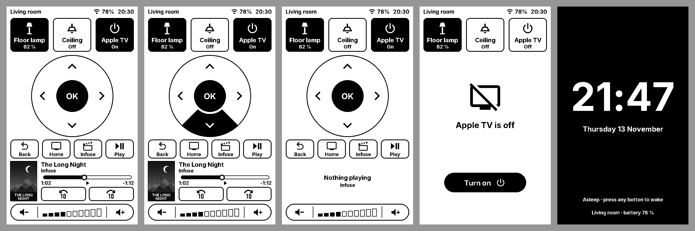

# Sticky Remote

A firmware that turns the Seeed **reTerminal Sticky** (ESP32-S3, 3.97" 800×480
e-paper, touch) into a remote for an Apple TV and one or two lights, through
**ESPHome** and **Home Assistant**. A web wizard flashes it and sets it up from
the browser, with no tools to install.



**Set one up:** open <https://frankynov.ovh/sticky/> in Chrome or Edge on a
computer, plug the Sticky in over USB-C and follow the steps. `?demo` on that
page runs the whole wizard without a Sticky or a Home Assistant.

> Status: runs on a real Sticky (display, Wi-Fi, Home Assistant, touch since 0.2.4). Sleep, wake and battery life are still to be confirmed; see
> [What to check on a real device](#what-to-check-on-a-real-device).

## What it does

| Area | What it does | Home Assistant |
|---|---|---|
| Top tiles | One or two lights (toggle, brightness) and the player's power | `light.toggle`, `media_player.turn_on/off` |
| Pad | ↑ ↓ ← → and OK, with on-screen feedback. Hold an arrow to repeat it | `remote.send_command` up/down/left/right/select |
| Keys | Back, Home, the app button (e.g. Infuse), Play/Pause | `remote.send_command` menu/home, `select_source`, `media_play_pause` |
| What's playing | A small artwork (dithered), title, series/episode or artist, app | `media_player` attributes |
| Seek bar | The position; tap anywhere on it to jump there | `media_player.media_seek` |
| Skip | −10 s and +10 s | `media_seek` |
| Idle / off | "Open Infuse" / "Turn on" | `select_source`, `turn_on` |
| Volume | − / + and a 10-step level | `media_player.volume_down/up` |
| Buttons | AI = sleep now (any button wakes it), Up/Down = volume | `volume_up/down` |

- **One firmware for every home.** What a Sticky controls is stored on the
  device, not compiled in: the player and its remote, the app button, the
  lights with their labels and icons, the room, and the typeface (Inter, or
  TRMNL's e-paper pixel fonts).
- **Onboarding on the device.** A fresh Sticky opens an open `Sticky-Remote`
  hotspot and shows a QR code to join it. Then it shows how to add it to Home
  Assistant.
- **One page, no tabs.** Everything is on screen at once, so nothing you do
  needs more than a fast partial refresh. The full refresh that clears
  e-paper ghosting waits until the Sticky has been left alone for 3 seconds.
- **Sleep**: on battery it deep-sleeps after 1, 3 (default), 10 or 30 minutes,
  or never by itself; the AI button puts it to sleep at once and any button
  wakes it. Asleep, the panel shows a dark "Asleep" screen, not the last state.
- **Touch sound** (Off, Quiet, Normal) and **Sleep after**: from the setup page
  or the Sticky's device page in Home Assistant (`select`s under Configuration).
- **Artwork** loads in a background task: download (HTTPS with certificate
  checks) and JPEG decode at 1/2, 1/4 or 1/8 scale never hold up touch or the
  screen. Other formats fall back to ESPHome's `online_image`.

## The setup page

- **First time**, five steps that move on by themselves: connect and install,
  Wi-Fi (networks the Sticky sees; the page checks that it joins), Home
  Assistant, Your remote (a live picture of the result; its button saves),
  then a checklist that ticks itself while you add the Sticky to Home
  Assistant and press a tile to try it.
- **A Sticky that's already set up** gets a short menu instead: update it,
  change what it controls, move it to another Wi-Fi, or start from scratch.
  Each runs only the steps it needs and keeps everything else.

## Privacy

Credentials stay with the person setting up the Sticky.

- The Wi-Fi password goes only to the Sticky, over USB.
- The Home Assistant token goes only to that Home Assistant, over its WebSocket
  API. It is kept in the page's memory and is gone when the tab closes. It is
  never stored on the Sticky.
- The HA address stays in the browser (localStorage), only if "Remember" is
  ticked.
- The site only serves static files: no analytics, no cookies, no server code.
  A Content-Security-Policy makes the browser enforce this. The page can load
  only its own files and open a WebSocket to the visitor's own HA.
- The firmware talks only to its own Home Assistant, through the ESPHome API.
  The API key is created by Home Assistant when the Sticky is added.
- Taps call HA actions, so HA asks you once to turn on **Allow the device to
  perform Home Assistant actions** for the Sticky. The wizard reminds you.

## Repository layout

| Folder | What's in it |
|---|---|
| `firmware/` | The ESPHome configs, the UI (`remote_ui.h`), device settings and the USB setup protocol (`sticky_device.h`), fonts |
| `engine/` | The firmware's UI compiled for a computer: a C API (`sticky_core.h`) over `remote_ui.h`, stand-ins for the ESPHome headers it uses, and a command-line renderer (`sim`) |
| `web/` | The setup wizard and web flasher served at frankynov.ovh/sticky |
| `design/` | Mockups (`mockup.py`), sample posters, the app icon |
| `docs/` | Plans |
| `Package.swift` | Exposes `engine/` as the `StickyCore` Swift package |

The engine is what keeps the previews honest: the web wizard's device images
are rendered by the firmware's own drawing code. A native Mac simulator also
builds on it; it isn't published yet.

## Building

You need ESPHome (2026.10 or later) and Python 3 with Pillow.

### The firmware

```bash
cd firmware && esphome compile sticky-remote-generic.yaml
```

- `sticky-remote-generic.yaml` is the firmware the wizard flashes: empty
  settings, Wi-Fi in setup mode, the MAC appended to its name
  (`sticky-remote-a1b2c3`), no OTA password. A fresh Sticky shows **Finish
  setup** until it receives settings over USB.
- `sticky-remote.yaml` is the base. Its `substitutions:` are the defaults for
  the device settings and can be overridden with `-s key value`. With
  `wifi_mode: builtin` it compiles in the network from `secrets.yaml`
  (`cp secrets.example.yaml secrets.yaml`); with `-s wifi_mode setup` it
  compiles none.
- No API key is compiled in: Home Assistant provisions one when the Sticky is
  added, and the Sticky keeps it across updates.

### The engine

```bash
engine/build.sh
python3 engine/make_fonts.py
```

`engine/build/sim` renders the UI to PNG from commands (`set`, `tap`,
`button`, `frame`…) on stdin.

### The web wizard

```bash
ESPHOME=/path/to/esphome web/build.sh
```

This compiles the generic firmware, writes
`web/firmware/sticky-remote-<version>.factory.bin` and `manifest.json`
(version, size, SHA-256), extracts the firmware's glyphs into `web/fonts/`,
renders `web/previews/`, then stages everything that goes online in
`build/upload/sticky/`, including `.htaccess` with the security headers.

- `python3 web/serve_local.py` serves the page locally without caching.
- `web/check_preview.py` compares the page's JS drawing with the firmware's
  render for the cases in `check_cases.json` (they should differ by 0 pixels).
- The flasher uses [esptool-js](https://github.com/espressif/esptool-js),
  vendored in `web/vendor/`.

## USB setup protocol

The console UART (115200 baud, through the CH343 bridge) carries the log and
newline-delimited JSON lines with `"sticky":"setup"`.

- `{"sticky":"setup","cmd":"get"}` → an info line: name, MAC, firmware
  version, Wi-Fi (connected, hotspot, IP, SSID), HA (connected, paired),
  `configured`, the settings and nearby networks. The board also sends it once
  at boot, with `"event":"hello"`.
- `{"sticky":"setup","cmd":"set","settings":{…},"wifi":{"ssid":"…","pass":"…"}}`
  saves either part and restarts: `{"ok":true,"saved":true,"restarting":true}`.
- `{"sticky":"setup","cmd":"reset"}` clears the settings.
- `{"sticky":"setup","cmd":"scan"}` starts a Wi-Fi scan; the networks come
  with the next `get`, a few seconds later.
- The info line's `caps` lists what the firmware supports beyond the first
  protocol (`scan`, `touch_sound`, `sleep_after`); the setup page hides what's missing.
- Development builds (`touch_calibration: "true"`) add
  `{"sticky":"setup","cmd":"calibrate"}` and `{"sticky":"setup","cmd":"touch_reset"}`.
  The info line's `touch` object gives the map in use and its source.
- Setting fields: `player remote player_name app app_label light1 light1_name
  light1_icon light2 light2_name light2_icon room ha_url font_set`. Icons are
  `bulb`, `ceiling`, `floor` or `star`; `font_set` is `inter` or `trmnl`.
  `touch_sound` (`off`, `quiet`, `normal`) and `sleep_after` (`1`, `3`, `10`,
  `30` minutes, or `never`) are accepted in `settings` too.
- Send at most 64 bytes every ~10 ms: the receive buffer is small.

## What to check on a real device

1. **Orientation**: if the screen is upside down, set `rotation: "270"`.
2. **Touch**: the GT911 reports portrait with y reversed; that map is built
   in (`touch_map`, measured on a real Sticky), so taps work out of the box.
   For development, building with `-s touch_calibration true` adds a
   calibration screen (hold **Down for 3 s**, or the USB `calibrate`
   command): tap five crosses, check test taps, press **AI** to save. The map
   it fits to the chip's raw coordinates is stored on the device and logged
   (`calibration: good … x=… y=…`), ready to copy into `touch_map`. Released
   firmware leaves it out and ignores any stored calibration. Every tap is
   logged as `touch x=… y=… raw x=… y=…`.
3. **Power latch**: the device stays on after you let go of the button.
4. **Sleep and wake**: after the chosen time on battery, or on an AI press, it
   shows the dark "Asleep" screen, and any button wakes it. On USB it stays awake
   unless you press AI.
5. **Artwork**: a poster shows up when something plays.

## Notes

- **Four greys (experimental)**: `-s grayscale true` builds for the panel's
  4-level mode. Full refreshes show the artwork in four greys; any partial
  refresh (a tap, the minute tick) turns the whole panel back to black and
  white until the next full one. The greys are layered on the black-and-white
  dither, so that state looks exactly like the default build.
- **Media details**: HA sends an attribute only when it changes and never
  says when one disappears, so the Sticky clears title, artist and series
  itself when playback stops or the app changes.

- Waking takes a few seconds while Wi-Fi and the HA connection come back. A
  static IP (`manual_ip:` under `wifi:`) shortens it.
- ±10 s seeks from the live position. Without one it falls back to
  `remote.send_command skip_forward/backward`.
- Taps answer at once with the expected result, and HA's state update then
  confirms or corrects it. A command leaves the moment the screen is touched;
  the e-paper only shows it.

## License

MIT, see [LICENSE](LICENSE). Fonts and vendored code keep their own licenses;
see [THIRD_PARTY.md](THIRD_PARTY.md).
